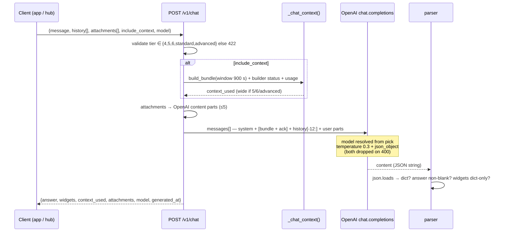
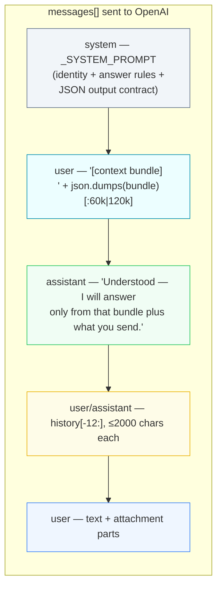
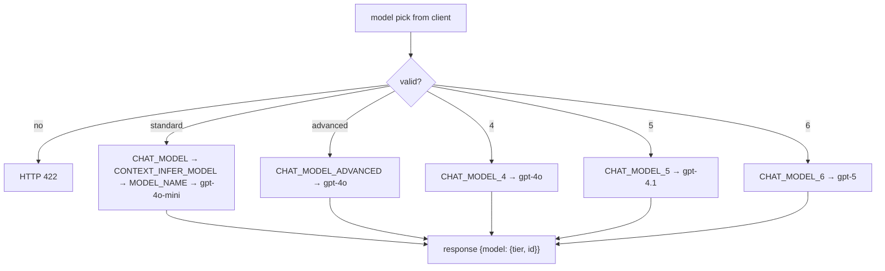
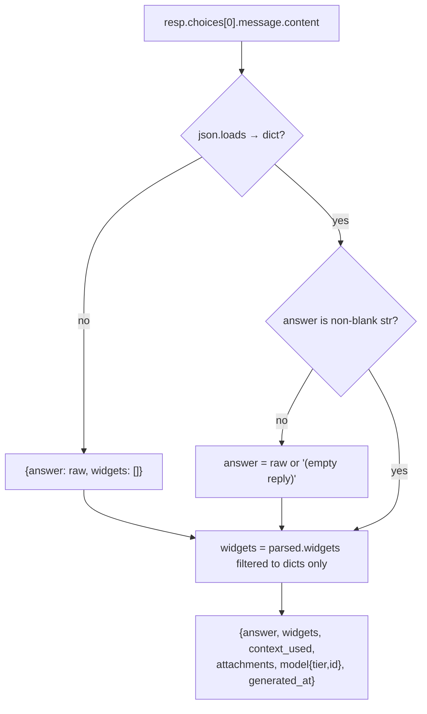

# Chat agent — prompt & output assembly

`POST /v1/chat` is the context-grounded assistant. This page documents,
end to end, **exactly how the prompt is assembled and how the model's
output is turned into the API response** — every bound, cap, filter and
fallback is implemented in
[`server/v1/chat.py`](https://github.com/Thothcraft/Brain/blob/main/server/v1/chat.py).

The other two LLM call sites (map builder, context infer) are documented on
[LLM prompts & responses](brain/llm-prompts.md).

---

## Pipeline at a glance



---

## Interactive walkthrough

Flip the model pick, toggle context, change history/attachment counts and
click each stage to see exactly what it produces and what the final
`messages[]` array looks like:

<iframe class="hw-embed" src="public/chat-flow.html" style="height:620px" loading="lazy"></iframe>

---

## Input → where it lands in the prompt

| `ChatRequest` field | Bound | Where it goes |
|---|---|---|
| `model` | `4`·`5`·`6` or legacy `standard`/`advanced`; else **422** | Resolved via `_model_for_tier()` → OpenAI `model`; also widens the bundle for `5`,`6`,`advanced` |
| `include_context` | default `true` | When true, `_chat_context()` output becomes a `user` message + canned `assistant` ack |
| `history[]` | last **12** turns, each ≤ **2000** chars, roles `user`/`assistant` only | Inserted between the bundle ack and the final user message |
| `attachments[]` | first **5**, images ≤ **8 MB** | Converted to OpenAI content parts (below), prepended to the user text part |
| `message` | text | First content part `{type: text}` of the final user message; if it's the only part the message is sent as a plain string |

Message or at least one attachment is required — otherwise **422**.

## The `messages[]` layout (verbatim order)



Steps 2–3 exist **only** when `include_context=true` — the fake assistant
ack is a delimiter so the model treats the bundle as already-agreed
ground truth rather than part of the latest question.

### The context bundle (`_chat_context`)

The assistant sees **the same `build_bundle()` output the map builder
consumes** (900 s window), so answers are grounded in the live map:

| Section | standard (pick 4) | wide (5 / 6 / advanced) |
|---|---|---|
| `map` | full semantic map (entities, relationships, live states, `confirmed` flags) | same |
| `devices` | `[:12]` registry rows | `[:30]` |
| `descriptors` | `[:12]` per-key aggregates | `[:32]` |
| `scenes` | `[:5]` latest node uplinks | `[:10]` |
| `reference` | radar/CSI empty-vs-occupied stats | same |
| `builder` | `{builds, last_build_at, last_summary, pending}` | **+ `last_proposal`** |
| `usage` | inference quota `{used, limit}` | same |

The bundle JSON is truncated to **60 000** chars (standard) or
**120 000** chars (wide) before being wrapped as
`"[context bundle]\n" + json` in a single `user` message.

### The system prompt (verbatim)

```text
You are the Thothcraft assistant answering questions about the user's
physical spaces, devices and activity. You receive a context bundle —
the same semantic map the context builder maintains (entities,
relationships, derived states; entries marked `confirmed: true` are
user-confirmed facts), a `devices` registry telling you which physical
machine each `device:<uuid>` / scene `device` id is (name, type, MAC,
hardware — anything not listed is an unknown emitter), recent evidence
descriptor aggregates and scene summaries — sensor entries carry
physical `fields` (mean/min/max/n for radar SNR, CSI variance, RSSI,
audio level…) plus node `estimates` and `location`, and `reference` —
measured empty-vs-occupied stats for the radar/CSI fields (E1 rig:
empty room snr mean ~7.6 dB tight, occupancy shows as snr_max spikes
>15-40 dB + map-mean lifts — a modest median SNR alone is weak) — then
the user's question and optional attachments.

Rules:
  * Answer ONLY from the bundle + attachments + conversation — never
    invent telemetry. Say when evidence is missing, stale or weak.
  * Confirmed facts win over inferred ones; describe inferred entries as
    tentative ("the system believes…").
  * You can explain what the model was shown — the user can ask "what
    context did you use?"; reference the bundle fields directly.
  * Be concise. No prose outside the JSON object.

Respond ONLY with this JSON shape:
{"answer": "<markdown text>",
 "widgets": [
   {"type": "list", "title": "…", "items": ["…"]},
   {"type": "key_values", "title": "…",
    "items": [{"label": "…", "value": "…"}]},
   {"type": "table", "title": "…",
    "columns": ["…"], "rows": [["…", "…"]]},
   {"type": "states", "title": "…",
    "items": [{"key": "…", "entity": "…", "value": "…",
               "confidence": 0.9, "confirmed": true}]},
   {"type": "questions", "items": ["natural follow-up question?"]}
 ]}
```

## Attachments → content parts

Each attachment (max 5) becomes OpenAI message parts plus a receipt note:

| Input | Rule | Part | Receipt note |
|---|---|---|---|
| `mime` starts `image/` | decoded size ≤ 8 MB else **413** | `{type: image_url, image_url: data:<mime>;base64,…}` | `image:<name>` |
| `application/pdf` or `.pdf` | first 10 pages via PyPDF2 | `{type: text, text: "[attached file '<name>']\n<pdf text ≤16k>"}` — if extraction fails, a placeholder text part | `pdf:<name>` |
| `text/*` or known text ext | decoded UTF-8 | `{type: text, text: "[attached file '<name>']\n<text ≤16k>"}` | `file:<name>` |
| anything else | — | text part saying the file was skipped | `skipped:<name>` |

Non-base64 payloads are rejected **422** up front.

## Model picks



Every hop is **env-overridable** — the deployed model ids can be changed
on Railway (`CHAT_MODEL_4/5/6`, `CHAT_MODEL`, `CHAT_MODEL_ADVANCED`)
without a code push. The response always echoes
`{"model": {"tier": <pick>, "id": <resolved id>}}` so the UI can display
which model actually answered.

## The OpenAI call — and its fallbacks

```text
chat.completions.create(
    model=<resolved id>, messages=messages,
    temperature=0.3, response_format={"type": "json_object"})
```

Reasoning-class models (gpt-5, o-series) reject `temperature` and/or
`response_format`. The call **degrades on `BadRequestError`** instead of
failing the turn: retry without `temperature`, then without
`response_format`. The whole call is metered by
`inference_call(kind="chat_query")` — `model_id` and `total_tokens` are
recorded against the user's monthly quota (**402/429** when exhausted).

## Output — JSON string → rich answer



So a malformed model reply can never break the endpoint — worst case the
user sees the raw text with no widgets.

### Response → UI

| Response field | Contract | App renders |
|---|---|---|
| `answer` | markdown — always present | markdown bubble |
| `widgets[]` | `list` / `key_values` / `table` / `states` / `questions` | inline rich cards; `questions` become tappable follow-up chips |
| `context_used` | the exact bundle the model saw (`null` when `include_context=false`) | "context used" → inspector dialog |
| `attachments[]` | per-file receipt notes | — |
| `model` | `{tier, id}` | caption under the bubble |

## Voice (same router)

| Endpoint | Purpose | Notes |
|---|---|---|
| `POST /v1/chat/transcribe` | audio → transcript | multipart, ≤ 25 MB, `CHAT_TRANSCRIBE_MODEL` (default `gpt-4o-mini-transcribe`), metered `chat_transcribe` |
| `POST /v1/chat/tts` | text → `audio/mpeg` | ≤ 4096 chars, `CHAT_TTS_MODEL`/`CHAT_TTS_VOICE` (default `gpt-4o-mini-tts`/`alloy`), metered `chat_tts` |
| `GET /v1/chat/context` | the bundle alone | "what the model sees" without spending an inference call |

## Guarantees worth relying on

- **Hallucination containment** — the prompt orders the model to answer
  only from the bundle; `GET /v1/chat/context` lets anyone audit exactly
  what it was given.
- **Confirmed beats inferred** — entities/states flagged `confirmed` are
  user facts the model must not contradict.
- **Metered** — every turn counts toward the monthly inference quota;
  the request is authorized with scope `chat:write`.
- **Degradable** — any OpenAI model id works: unsupported params are
  dropped on 400, and a non-JSON reply degrades to plain text.
